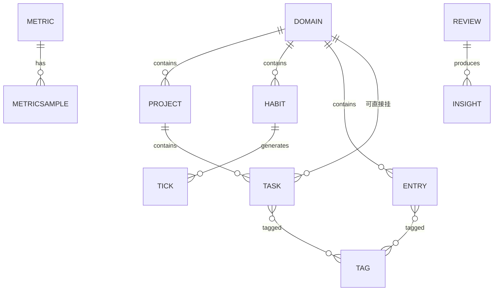

# 个人成长 OS —— 产品、逻辑与架构规划

> 文档版本：v0.1（决策初稿）　|　日期：2026-11-10
> 输入基线：《Things 3 产品架构与逻辑梳理》
> 已锁定决策：① 成长档案为中心　② CloudKit 起步、后期加服务端　③ 订阅制
> 阅读方式：**加粗的是判断**，普通文字是依据。凡未标注来源的工程数字，均属**假设**，需在 M0 验证。

---

## 零、先说核心判断（不读全文也该读这段）

**判断 1：这个产品不能是"Things 3 + 四个新分类"。**

Things 3 的数据模型是**任务终态制**——一件待办做完就进 Logbook，系统从此不再关心它的时间维度。这个模型对"有外部截止、有明确产出"的工作项目是完美的，但对"健康、健身、饮食、审美"是失效的：这四者的价值不在"做完"，在**变化**。三个月前的体重曲线、训练容量的爬升、读过的书怎么迁移了你的口味——这些在任务模型里**无处安放**。

所以本产品的数据底座必须是 **append-only 的事件流**（一次训练、一餐、一部电影、一次体重测量，都留痕且不可变），而非任务状态表。任务只是事件的触发器之一。

**判断 2：产品的主视图是"周回顾"，不是"今天"。**

大多数待办 App 只有日节奏，用户每天早上看一次清单。但成长类产品的留存驱动力是**看见自己变好**，这个体验只能在周/月尺度的对比中出现。因此本产品是**四节奏产品**：日（60 秒，执行）→ 周（10 分钟，校准）→ 月（20 分钟，洞察）→ 年（仪式，身份认同）。Things 3 只有第一层。**第三、第四层才是订阅的商业根基。**

**判断 3：健康、健身的核心数据 80% 不该由用户手输。**

体重、睡眠、静息心率、HRV、训练记录，Apple Watch + 健康 App 已经在免费采集且比任何手动输入都准。若本产品让用户手输这些，必死——因为用户会问"我为什么要录入 iPhone 已经知道的东西"。

**本产品在健康领域的真正价值不是"记录"，是"翻译"**：健康 App 给你数字（昨晚睡了 6 小时 12 分），不给你因果（因为周三练腿后入睡晚了，连续三周如此）。把原始信号翻译成人生叙事，才是不可替代的位置。

**判断 4：七个领域里，只有"审美提升"是 Things 3 完全无法覆盖、且竞品也做得差的空白。** 它是本产品最容易做出差异化的模块，也最容易被做砸（做成"我想看的 10 部电影"清单）。它的正确形态是**输入画像**：不是管理"要看什么"，而是呈现"我的输入在往哪个方向迁移"。

**判断 5：v1 应该刻意做小。** 见第十一章的砍单清单。六个域全部完整实现，是小团队六个月内做不完的；做到一半的六个域，不如做扎实的三个域。

---

## 一、目标、约束与成功标准

### 1.1 真正要解决的问题

不是"帮用户管理任务"，而是：**让一个成年人在工作、身体、审美、心智四条线上同时推进，并且六个月后能看见自己确实变了。**

这句话可拆成两个可验证的子问题：

| 子问题 | 失败的典型表现 | 本产品的应对 |
|---|---|---|
| 执行层：今天该做什么，且不焦虑 | 清单越长越不想打开 | 日视图严格限量（见 4.1） |
| 反馈层：我变了吗，变得对吗 | 用了半年，感觉什么都没变 | 周/月回顾 + 趋势 + 洞察 |

### 1.2 约束条件（明确写下来，避免后期拉扯）

| 类型 | 约束 |
|---|---|
| 平台 | 主力 iPhone / iPad / Apple Watch。**v1 不做 Mac、不做 Web、不做 Android** |
| 系统 | iOS 18+ / watchOS 11+（需核实目标用户覆盖率后再定，见 11.4） |
| 数据主权 | 数据默认存用户自己的 iCloud 私有库，不上传任何第三方服务器（v1） |
| 成本 | v1 无服务器成本；AI 走端侧或用户自带 Key |
| 合规 | 不做医疗诊断、不做用药建议；HealthKit 数据不得用于广告 |
| 商业模式 | 订阅制，必须有免费层与付费层 |

### 1.3 成功标准（可量化，否则无法判断对错）

假设 v1 上线 12 个月，判断成功的门槛：

| 指标 | 目标 | 为什么是这个数 |
|---|---|---|
| D30 留存 | ≥ 25% | 效率类 App 行业中位约 12–15%，能到 25% 说明"周回顾"确实形成习惯 |
| 周回顾完成率 | ≥ 40% 的活跃用户每周完成一次 | 这是产品的核心机制，低于 40% 说明仪式设计失败 |
| 付费转化 | ≥ 4% 的 D30 留存用户 | 参考健康/效率类订阅的常见区间 |
| 人均每日有效录入 | ≤ 60 秒 | 超过即意味着录入摩擦过大，长期必然流失 |
| 数据回填率（健康） | ≥ 70% 用户授权 HealthKit | 低于此说明授权引导或价值沟通失败 |

**注意：这些是假设值，需在 M0 后按实际市场调研校准，但它们给了设计一个明确的靶子。**

---

## 二、第一性拆解：为什么不能照抄 Things 3

把 Things 3 的成功条件与本产品的成功条件并排放，差异立刻显形。

| 维度 | Things 3 | 本产品 | 架构含义 |
|---|---|---|---|
| 核心情绪 | 怕忘（焦虑驱动） | 想变好（动机驱动） | 不能靠红色角标和逾期警告做留存，要靠正向反馈 |
| 数据形态 | 可终结的任务 | 不可终结的信号流 | 必须事件日志，不能只有状态表 |
| 主视图 | 今天 | 今天（轻）+ 回顾（重） | 需要两套完全不同的信息密度 |
| 时间语义 | 一个点（何时做） | 一条线（趋势）+ 一个点 | 必须有聚合层 |
| 成功瞬间 | 勾掉 | 看见变化 | 成就感的载体是图表和文案，不是复选框 |
| 犯错成本 | 忘事 | 误判自己（以为在进步其实没有） | 数据必须可信，宁可少录不能假录 |
| 社交性 | 无（私密） | 无（更私密，涉及身体与审美） | 同样不做协作，且不做任何公开分享 |

**可以直接继承的 Things 3 遗产**（这几条已经是被验证的工程智慧，不用重新发明）：

1. `when`（打算何时做）与 `deadline`（最晚何时完成）拆成两个字段。
2. "取消"是一等状态，与"完成"并列，且都留痕进日志。
3. 项目完成由系统推导，不允许一键勾完。
4. 重复规则改期时必须二选一："只改这一次"还是"改今后规则"。
5. 标签扁平无层级（层级化分类最终会退化成第二棵项目树）。
6. 外壳分平台、内核共享。
7. 把领域模型开放成窄接口（URL Scheme / Shortcuts），让 App 可被自动化编排。

**必须抛弃的**：Logbook 那种"已完成即消失"的归档逻辑。本产品的"完成"不是终点，是**事件流里的一个点**，永远可被再次聚合。

---

## 三、七个领域的真实数据形态（全篇最关键的一节）

多数同类产品失败在这里：把七个领域平铺成七个清单。实际它们分属三种形态，需要三套不同的交互与一套不同的数据表。

### 3.1 形态分类

| 形态 | 领域 | 数据本质 | 核心交互 | 成功度量 |
|---|---|---|---|---|
| **A 履约型**（有外部承诺、有终态） | 工作、生活/兴趣 | 任务 / 项目 | 勾选、排期 | 完成率 |
| **B 信号型**（无终态、看趋势） | 健康、健身、饮食、审美 | 时间序列 / 带标签条目 | 自动采集 + 极简录入 | 趋势方向、数据密度 |
| **C 连续型**（有 streak，断裂即信息） | 习惯（横切所有领域） | 打卡事件 | 单次点击 | 连续性与一致性 |

**关键设计推论：**

- A 类用 Things 3 的全套结构（Area→Project→Task→Checklist）。
- B 类**不能有"完成"按钮**。一顿饭没有"完成"，只有"记录了"。UI 上要彻底避免复选框，否则用户会把它当待办，然后因为"永远做不完"而放弃。
- C 类不产生 Task。习惯的实体是 **Tick（打卡事件）**，连续性是计算出来的，不是存储的。

### 3.2 逐域拆解

#### 工作

形态 A。**这是唯一可以近乎照搬 Things 3 的领域**，但要做两处增强：

- **专注会话与中断记录**：番茄钟不是重点，重点是**记录中断**（谁打断的、为什么）。一个月后，"你这个月被打断 47 次，其中 31 次来自即时通讯"是有行动价值的洞察，而"我专注了 20 小时"没有。
- **日终收尾**：下班时强制 30 秒——今天完了什么、什么卡住了、明天第一件事是什么。这是把 A 类数据流进回顾层的入口。

**不做**：甘特图、看板、工时统计、多人协作。这是个人成长工具，不是项目管理工具。

#### 生活 / 兴趣爱好

形态 A + B 混合。本质是**探索性**，没有 KPI，最容易被做成"清单坟场"。

核心机制是**入口必须有出口**：建一个"**想做池**"（Someday 的升级版），每周回顾时必须从中**挑一个进本月，或删掉一个**。这个"强制流动"是抵抗清单腐化的唯一办法。

同时保留 Entry 形态的记录：读完一本书、看完一场展，留下条目而非只勾个框。

#### 健康

形态 B，**数据 90% 来自 HealthKit**：体重、体脂、睡眠分期、静息心率、HRV、步数、血氧。

产品动作只有三件：
1. **接入与清洗**（去重、异常值处理、单位统一）
2. **趋势呈现**（周/月滑动平均，而非每日抖动；体重曲线必须用 7 日移动平均，否则用户会被水分波动吓退）
3. **异常提示**（规则引擎即可，不需要 AI）："静息心率连续 5 天高于基线 8bpm"

**红线**：不做诊断、不做疾病风险预测、不给用药或就医建议。所有涉及健康的解读文案必须经过"这不是医疗建议"的表述审查。

#### 健身

形态 B，**但力量训练必须手动录入**——这是 HealthKit 唯一不覆盖的部分，也是健身用户最在乎的部分。

数据结构：`Exercise（动作库）→ Session（一次训练）→ Set（组：重量 × 次数 × RPE）`。

三个关键指标：训练容量（volume = Σ 重量×次数）、周频次、个人纪录（PR）。

**这是 Apple Watch 的主战场**：手腕上完成组间记录，不掏手机。Watch 端要做"下一组"的一键预填（继承上一组参数）。

**跨域联动是本产品的高价值点**：训练时间 → 当晚睡眠 → 次日静息心率。三者串起来才能给出"你周三练腿太晚，代价是周四全天的状态"这种洞察。

#### 饮食

形态 B，**v1 必须极简，否则一定失败**。

原因很直接：卡路里精算这条路，MyFitnessPal 已经做了 15 年、有千万级食物数据库，正面打不过；而且逐项录入的成本会直接摧毁留存。

v1 只做三件事：
1. **餐次打点**（早/午/晚/加餐 + 一张照片 + 可选一句话）
2. **主观评分**（满足感、饱腹感、餐后精力）—— 这三个主观值比热量数字更能指导行为
3. **食材多样性**（这个月吃过多少种蔬菜/蛋白来源）—— 一个几乎无人做但很有价值的指标

后期可选：接入 HealthKit 的 dietary 数据（由其他 App 写入）、拍照识别（成本高，慎入）。

#### 审美提升

形态 B，**这是全产品最独特的模块**。

错误的做法：做成"我要看的 100 部电影"清单。正确的做法：**输入画像**。

数据单位是 `Entry(type: media)`：电影 / 展览 / 书 / 专辑 / 设计作品 / 空间体验，带评分、一句话反思、风格标签。

产品输出三样东西：
1. **输入量与构成**（本月看了什么类型，比例如何）
2. **品味迁移**（半年前你打高分的和现在打高分的，风格标签怎么变了）
3. **连接**（看完某部电影 → "我想学这个" → 一键进想做池 → 变成 A 类项目）

**不做推荐算法。** 推荐是流媒体的战场；这里做的是"照镜子"，不是"喂饲料"。

#### 成长（元层，不是第七个分类）

**这不是一个领域，是横切在前六个之上的报告层。** 这是必须讲清楚的一点，否则会被误做成第七个清单。

它包含：周回顾、月回顾、年度画像、跨域洞察。

最有商业价值的是**年度"时光轴"**：把一年的高光、转折、增长曲线做成一份可以反复回看的档案。这是订阅续费的情感理由，也是分享传播（若未来开放）的素材。

---

## 四、产品节奏设计（产品的灵魂）

四个节奏，每个节奏有固定入口、固定时长、固定产出。**节奏本身就是产品**，不是功能的堆叠。

### 4.1 日节奏（60 秒）

| 时点 | 动作 | 时长 | 设计要点 |
|---|---|---|---|
| 早晨 | 看"今天" | 20 秒 | 只显示今天：任务（≤7 条）+ 日历 + 今日习惯 |
| 全天 | 随手记 | 5 秒/次 | 任何入口都能一步落到正确位置 |
| 睡前 | 收尾 | 30 秒 | 未完成项的处置（不是指责，是分流）+ 一句自由记录 |

**设计要点：日视图必须限量。** 超过 7 条待办，用户的选择成本会超过执行成本。超出的自动跌到"随时"。

### 4.2 周节奏（10 分钟，周日晚）

这是产品**最重要的 10 分钟**。四个区块，顺序不可换：

1. **本周完成了什么**（给正反馈，不可跳过）
2. **数据趋势**（健康/健身/习惯三条线，各给一句人话解读）
3. **想做池处理**（必须全清：每个条目要么进本月，要么删，要么延后——不允许"原地不动"）
4. **下周三个重点**（只允许三件，强制取舍）

**这四步的顺序是有因果的**：先肯定 → 再看数据 → 再清理欲望 → 最后做计划。反过来的话（先规划），用户会跳过前三步，回顾就退化成又一个待办页面。

### 4.3 月节奏（20 分钟）

比周回顾多三件事：跨域趋势对比、一段自由书写（"这个月我发现了什么"）、下月主题词（一个词，不是目标列表）。

### 4.4 年节奏（不收时间）

时光轴 + 年度画像（六域各一段）+ 给明年自己的一封信。**这是产品的情感高点，也是订阅续费的核心。**

### 4.5 节奏的实现约束

**回顾必须是产品的一等公民，不能是"统计页"。** 判据：如果回顾页可以被用户忽略而不产生任何后果，那它就失败了。做法是——回顾完成后才解锁下周重点规划，未完成的回顾在周视图顶部保持一条常驻提示（不弹窗、不红点）。

---

## 五、数据模型

### 5.1 建模原则

1. **事件不可变**（append-only）。改期不覆盖原计划，而是追加一条 `rescheduled` 事件，历史保留。这使趋势计算与冲突合并都变简单。
2. **状态是投影**。任务/项目的"当前状态"由事件推导并缓存，可随时重建。
3. **跨端无冲突**：不可变事件天然可合并（并集即可），只有少数可变字段走 last-writer-wins。

> **务实取舍**：不做全量 Event Sourcing（对一个个人 App 属过度设计）。做法是——主实体用常规表（可改），同时为关键状态变更追加 `HistoryEvent`。即"状态表 + 变更留痕"，而非"纯事件溯源"。这是 V1 的正确复杂度。

### 5.2 实体清单

| 实体 | 说明 | 关键字段 |
|---|---|---|
| `Domain` | 人生支柱（7 个内置 + 自定义） | name, icon, tintColor, order |
| `Project` | 有终点的产出物 | domainID, title, status(active/completed/canceled), completedAt |
| `Task` | 原子行动 | projectID?, **when**, **deadline**, status, kind(oneOff/repeating/derived) |
| `Habit` | 习惯定义 | domainID, cadence(每日/每周N次/自定义), target, streakMode |
| `Tick` | 打卡事件 | habitID, timestamp, value?, note? |
| `Metric` | 指标定义 | key, unit, source(healthkit/manual/derived), aggregation |
| `MetricSample` | 测量点 | metricID, value, startDate, endDate, sourceDevice |
| `Entry` | 生活记录原子单位 | type(workout/meal/media/moment), domainID, date, payload(JSON), rating?, reflection? |
| `Review` | 回顾产物 | scope(weekly/monthly/yearly), periodStart, periodEnd, body, themeWord? |
| `Insight` | 系统生成的观察 | kind(rule/ai), title, body, evidenceRefs, state(new/seen/dismissed) |
| `Tag` | 扁平标签 | name, usageCount |
| `HistoryEvent` | 变更留痕 | entityType, entityID, changeType, payload, timestamp |

### 5.3 关系图



### 5.4 必须继承的三条强约束

1. **Task.when 与 Task.deadline 正交**。`when ∈ {today, tomorrow, evening, anytime, someday, date}` + 独立 deadline。
2. **Project.completed 不可直接写入**，除非所有子 Task 已终态（completed/canceled）。系统拒绝一键勾完。
3. **重复任务改期**时必须返回二选一决策，不允许静默改规则。

### 5.5 容量上限（写进模型，不是写进文档角落）

参照 Things 的做法，把边界明确下来：单项目任务 ≤ 500、Checklist ≤ 100、notes ≤ 10,000 字符、单 Entry 反思 ≤ 4,000 字符、单日 Entry ≤ 50。

---

## 六、各模块业务逻辑要点

### 6.1 输入路径（决定留存的第一道门槛）

一个想法进入系统，只允许 **≤ 2 步**。路径设计：

| 入口 | 落点 | 关键要求 |
|---|---|---|
| 全局快速录入（长按 / 快捷指令 / Siri） | Inbox | 只输入文字即可，其余全部可空 |
| 分享扩展 | 对应 Entry | 其他 App 分享链接/图片 → 自动判型 |
| 主屏/锁屏小组件 | 快速打卡 / 今日任务 | 单点完成，不打开 App |
| Watch | 训练记录 / 打卡 | 手腕上闭环 |
| 相机（餐次） | Entry(meal) | 拍完即存，评价可后补 |

**Inbox 必须是唯一"无归属"状态**，且必须每周清理一次（否则退化成第二个坟场）。

### 6.2 重复与习惯的区别（容易混淆，必须分清）

| | 重复任务（Task.kind = repeating） | 习惯（Habit） |
|---|---|---|
| 语义 | 这件事会再次发生，要产生新待办 | 我在养成一个行为，要看连续性 |
| 实体 | 生成新的 Task | 生成 Tick 事件 |
| 缺失一次 | 逾期 / 改期 | streak 断裂（且断裂本身是信息） |
| UI | 复选框 | 圆环 / 点阵 |
| 举例 | 每月 5 号交房租 | 每天冥想 10 分钟 |

**不要把习惯做成重复任务。** 二者的失败反馈完全不同：任务逾期该提醒，习惯断裂该**分析**（为什么断的），不该被红字羞辱。

### 6.3 洞察引擎（v1 用规则，不用 AI）

v1 的 Insight 全部来自规则，不依赖任何模型，可解释、零成本、零延迟：

- 相关性哨兵：训练日 vs 非训练日的次晨静息心率差 ≥ 5bpm
- 连续性哨兵：某习惯 streak ≥ 21 天 → 提示"已稳定，可考虑停止追踪"
- 失衡哨兵：某 Domain 连续 3 周无任何 Entry → 单独提示（温和措辞）
- 负荷哨兵：本周训练容量较 4 周均值上升 > 40% → 提示恢复
- 输入画像哨兵：本月审美输入量 < 3 → 提示（不评判）

**规则优先于 AI 的理由**：个人数据量小（几百条），统计方法足够；规则可解释，用户信任成本低；零推理成本，不侵蚀订阅毛利。AI 留给 v2 的"叙事生成"（把规则输出写成一段有人味的文字）。

---

---

## 七、技术架构与选型

### 7.1 分层原则

沿用 Things 3 已被验证的取舍——**外壳分平台、内核共享**：

```
┌──────────────────────────────────────────────┐
│  App-iOS        App-Watch        Widgets      │  外壳：各自原生导航与交互
│  (SwiftUI)      (SwiftUI)        (WidgetKit)  │
└───────────────────┬──────────────────────────┘
                    │  调用
┌───────────────────▼──────────────────────────┐
│  GrowthCore（Swift Package）                  │  内核：纯逻辑，零 UI 依赖
│  · Models（实体定义）                          │
│  · Rules（项目完成推导 / 重复规则 / streak /   │
│           指标聚合 / 洞察规则）                 │
│  · UseCases（用例编排）                        │
│  · Repository 协议层                          │
└───────────────────┬──────────────────────────┘
                    │  实现
┌───────────────────▼──────────────────────────┐
│  GrowthData（Swift Package）                  │
│  · 持久化栈 + CloudKit 同步                    │
│  · HealthKit 适配器                           │
│  · 导入导出（JSON 备份）                       │
└──────────────────────────────────────────────┘
```

这样拆的收益很具体：Watch 端不需要复制业务规则（streak 怎么算、项目何时可完成），只写 UI；规则改动一处生效三端；内核可单测，不依赖模拟器。

### 7.2 技术选型表

| 层 | 选型 | 理由 | 置信度 |
|---|---|---|---|
| UI | **SwiftUI** | 三端统一语言；iOS 18 后的 List 性能已能满足千条级；与 WidgetKit 天然一致 | 高 |
| 图表 | **Swift Charts** | 系统原生、深浅色自适应、动效可控 | 高 |
| 持久化 | **Core Data + NSPersistentCloudKitContainer** | 成熟、迁移工具完善、冲突策略明确 | 中（见 7.3 需验证） |
| 同步 | **CloudKit Private DB** | 零运维、零成本、Apple ID 免注册、隐私合规最简 | 高 |
| 健康 | **HealthKit** + HKObserverQuery 后台投递 | 唯一权威数据源 | 高 |
| 提醒 | **UserNotifications** + Time Sensitive | 需要 entitlement 申请 | 高 |
| 小组件 | **WidgetKit**（主屏/锁屏/StandBy/Smart Stack） | 留存关键触点 | 高 |
| 手表 | watchOS App（companion）+ **WatchConnectivity** | 见 7.4 的限制 | 中 |
| 订阅 | **StoreKit 2** | 本地验签 + 后续接 App Store Server API | 高 |
| AI | v1 不做；v2 端侧模型或 BYO Key | 成本与合规双重考量 | — |

### 7.3 三个必须在 M0 验证的技术假设

这三条如果成立错了，后面所有排期作废。**M0 就是为了证伪它们。**

**假设 A：Core Data + CloudKit 能承载本产品的同步负载。**

- 风险点：NSPersistentCloudKitContainer 对唯一约束支持弱；大批量导入（HealthKit 首次拉取可能一次几千条 MetricSample）可能触发 CloudKit 请求配额限制。
- 验证方法：写一个 spike App，构造 5,000 条 MetricSample + 500 条 Task + 200 条 Entry，在两台设备上做并发写入，测量：首次同步耗时、冲突发生率、单次批量写入上限。**如果批量写入被 CloudKit 限制卡住，解决方案是把 HealthKit 原始样本留在设备本地、只同步聚合结果（这是可接受的降级）。**

**假设 B：SwiftData 是否已可替代 Core Data。**

- 现状：SwiftData 在 iOS 18 已有显著改善，但 CloudKit 同步相关的能力仍在演进，且迁移路径不如 Core Data 成熟。
- 验证方法：同一份模型用 SwiftData 实现一遍，对比 CloudKit 同步稳定性与 schema 迁移体验。结论只取一个，不混用。

**假设 C：Watch 在脱离 iPhone 时可用。**

- 事实层面的限制：watchOS 上 CloudKit 的直接支持有限，主流做法是 Watch App 通过 WatchConnectivity 与 iPhone 端通信，iPhone 端负责持久化与同步。
- **这意味着**：Watch 不带手机时（跑步、健身房），数据先落 Watch 本地，回到手机附近再回传。这是可接受的设计，但必须在 UI 上明确（"待同步"状态），不能让用户以为数据丢了。
- 验证方法：真机测试 Watch 离线记录 30 组训练数据 → 回连后的补传完整性与耗时。

### 7.4 同步与冲突策略

数据分三类，各自的策略不同：

| 数据类 | 特征 | 冲突策略 |
|---|---|---|
| 不可变事件（Tick / MetricSample / HistoryEvent） | 只追加 | 并集合并，天然无冲突 |
| 可变实体（Task / Project / Entry） | 可编辑 | 字段级 last-writer-wins + 保留冲突副本（不静默丢弃） |
| 用户产出（Review 正文） | 手工写作，价值最高 | 冲突时**绝不自动合并**，保留两份让用户选 |

最后一条是很实际的考虑：用户手写的月度回顾被自动合并覆盖，是能直接导致卸载的事故。

### 7.5 数据安全底线

个人成长数据（体重、睡眠、看过什么、写了什么）是高度敏感的，且**丢失不可挽回**。三条必须做：

1. **本地导出**：任何时刻可导出全量 JSON（含 Entry、Review 正文），格式公开。
2. **iCloud 备份说明**：明确告知用户数据在 iCloud 中，且给出"如何确认已同步"的指引。
3. **删除双确认**：删除 Domain / Project 时展示受影响条目数，二次确认；提供 30 天回收站。

### 7.6 性能预算

| 场景 | 预算 | 备注 |
|---|---|---|
| 冷启动到今日视图可交互 | < 1.2s | iPhone 12 及以上 |
| 滚动 1,000 条任务列表 | 60fps 不掉帧 | 需用稳定的 id 与预取 |
| 周回顾生成（含图表） | < 800ms | 聚合走后台队列，先出骨架 |
| 打卡反馈（点击到视觉完成） | < 100ms + 触感 | 这是产品的高频"爽点"，必须极致 |
| HealthKit 首次全量拉取 | 后台完成，不阻塞 UI | 30 天回填作为默认，不做全历史 |

---

## 八、视觉系统（house style）

本产品沿用 **designer-app-studio** 系列风格（源产品：设计师罗盘 Pro）。这是硬约束，不是参考：同一套 token、同一套导航结构、同一套控件几何。目的是让系列内的 App 在用户手机上是同一个家族的产品。

### 8.1 这套风格是什么

一句话：**像一件放在深色制图台上的精密仪器**——安静、克制、编辑感、专业。不是通用分析仪表盘，也不是生活方式健康 App。

v0.1 曾按 Things 3 与 Gentler Streak 的思路做过一版浅色纸底方案（墨绿 + 米白 + 大圆角卡片 + 回弹勾选动效），**已废弃**。原因不是它难看，而是它不属于这个系列，会让系列内的 App 彼此割裂。

### 8.2 Token（照抄，不另行发明）

| 用途 | 值 |
|---|---|
| 页面底色 | `#12100E`（`--ink`） |
| 抬升面板 | `#1B1815`（`--plate`）/ `rgba(232,223,208,.025)` |
| 正文 | `#E8DFD0`（`--bone`，骨白） |
| 次要文字 | `#8C8276`（`--ash`） |
| 主强调 | `#C2954F`（`--brass`，铜） |
| 正向 / 完成 | `#6F8F7B`（`--jade`，青玉） |
| 警示 / 冲突 | `#A4503C`（`--cinnabar`，赭） |
| 分隔线 | `rgba(232,223,208,.10)`，1px |

字体：标题用中文衬线（Songti SC / Noto Serif SC），字重 400，字距 0.06–0.18em；正文与控制用系统无衬线；数值用 light 字重 + 等宽数字。

### 8.3 不可违反的六条

1. **标题用衬线、字重 400**，不用粗体无衬线做大标题。
2. **方角控件 + 1px 细边框**。圆角胶囊只用于浮动返回按钮与紧凑状态 chip。
3. **不用饱和渐变**。只在首页仪器背后允许一层极低透明度的铜色径向光晕。
4. **动效 150–350ms，无回弹、无弹性、无持续装饰动效**。v0.1 里那个带回弹的勾选动画必须拿掉。
5. **底部导航固定 5 格**（四个主去处 + 更多），选中态为铜色 + 22×2px 顶部标记。
6. **每屏只有一个视觉焦点**：仪器、图表、清单或结果。

### 8.4 落到本产品的信息架构

- 导航：**今天 / 训练 / 记录 / 年轮 / 更多**
- 语音入口从 v0.1 的"凸起圆形按钮"改为导航第三格的「记录」——这套风格不允许异形浮动主按钮
- 回顾是「年轮」的内页，走左下浮动返回胶囊，不占导航格
- 单屏任务上限压到 **3 条**（v0.1 是 7 条）：这套风格靠留白与对比建立层级，塞满会立刻失去气质

### 8.5 为什么"阳光感"在这里仍然成立

v0.1 定过一条原则：阳光感放在视觉与结构里，不放在文案形容词里。深色制图台风格看起来冷，但它承载阳光的方式是材质而非明度：

- 铜色本身是暖色（不是冷灰蓝）
- 骨白而非纯白，有织物与纸的质感
- 年轮是全产品唯一的图形主角，生长隐喻直接可读
- 趋势线用青玉色表达"在变好"，赭色只留给"需要动手"

**暖不等于浅色。** 这套系统的暖在材质层面，不在明度层面。

---

## 九、上架与应用商店约束

这一节是**执行红线**，不是建议。在 App Store 面临的问题集中在四类。

### 9.1 健康数据的合规

| 约束 | 具体要求 | 应对 |
|---|---|---|
| HealthKit 数据用途 | Apple 明确禁止将 HealthKit 数据用于广告、出售给数据经纪商、或用于未经用户同意的第三方 | 隐私政策必须写明：健康数据仅存于用户 iCloud，不上传任何第三方服务器 |
| 不得做医疗声明 | 不能诊断、不能预测疾病、不能给用药建议 | 所有健康解读文案走"观察陈述"而非"医学结论"；首次进入健康模块展示免责声明 |
| 权限文案 | HealthKit 的用途说明字符串会被审核逐条检查 | 每条权限的文案要具体到"用于什么功能"，不能写"为了改善体验" |

**这一条是本产品最大的审核风险**，因为"洞察"天然接近"建议"。边界应当划在：**陈述相关性，不给因果定论，不引导医疗行为**。（例：可以说"你的训练日次晨心率普遍偏高"，不能说"你训练过度了，应当减少"。）

### 9.2 订阅合规

1. 必须使用 StoreKit 内购，**不得引导用户去 App 外支付**（包括文字提及、按钮链接）。
2. 付费页必须清晰展示：订阅周期、价格、自动续订说明、取消方式入口、隐私政策与用户协议链接。
3. 必须提供"恢复购买"。
4. 免费试用若有时长，需在购买确认页明确说明试用结束后会自动扣费。
5. 提供免费层的产品，**免费层的功能必须真实可用**，不能是"空壳试看"（否则触 4.2 最低功能性）。

### 9.3 技术与元数据

| 项 | 要求 |
|---|---|
| Privacy Manifest（PrivacyInfo.xcprivacy） | 必须提供，列明所用 Required Reason API 与数据收集类型 |
| 账号删除 | 若引入任何账号体系（v2 自建后端时），必须支持**应用内删除账号** |
| AI 生成内容 | 若 v2 引入 AI 生成文本，需在相应位置标明来源 |
| 截图 | 六域功能都要出现在截图中，避免"截图与实际功能不符"被拒 |
| 年龄分级 | 涉及健康数据，建议 12+ 或 17+（依具体内容定，需复核） |

### 9.4 名称与商标（见第十章）

App Store 名称需做**商标检索 + 现有 App 查重**，两者都通过才能定名。中文名与英文名要分别检索。

---

## 十、命名候选

未定名，给方向与候选。**所有候选均需自行完成商标检索与 App Store 查重后再定。**

### 10.1 命名需要满足的约束

短（≤ 3 音节）、可读（英文母语者与非母语者都能念）、语义指向"生长/时间/记录"、不与知名 App 冲突、域名与社交账号可获取。

### 10.2 英文候选

| 候选 | 语义 | 评估 |
|---|---|---|
| **Almanac**（年鉴） | 记录一年四季的册子 | 语义最贴"人生年鉴"；但已有同名产品，需查重 |
| **Perennial**（多年生） | 植物年年复生 | 语义极好（成长的非一次性）；偏长，可缩写 Peren |
| **Trellis**（棚架） | 让藤蔓向上攀的结构 | **结构感 + 生长感的双重隐喻，与本产品"给成长搭结构"的定位高度吻合**；需查重 |
| **Meridian**（子午线/顶点） | 时空坐标 | 气质好但偏抽象，与产品关联弱 |
| **Axis** | 轴心 | 短、好记，但语义空 |
| **Cadence**（节奏） | 韵律 | 与本产品的四节奏理念直接呼应；已有同名健身 App，需避让 |

**推荐优先级：Trellis > Almanac > Perennial。**

### 10.3 中文候选

**年轮**（时间累积的可见痕迹）、**四时**（四季，天然的时间维度）、**刻度**（可量化的成长）、**长进**、**生涯**、**纪**。

**推荐：年轮**（与 Trellis 的"生长"隐喻同源，且"年轮"本身就是一每年增长一圈的可见档案，与本产品最核心的差异化——年度时光轴——完全同构）。

---

## 十一、里程碑、风险与待决清单

### 11.1 排期（**假设：1–2 人全职小团队**）

| 阶段 | 内容 | 工期 | 交付判据 |
|---|---|---|---|
| **M0 技术验证** | 验证 7.3 的三个假设；真机跑通 CloudKit 双向同步、HealthKit 后台投递、Watch 离线补传 | 2–3 周 | 三个假设全部有明确结论（成立/降级方案） |
| **M1 数据底座** | 全部实体 + 仓储 + 同步 + 导入导出 + 回收站 | 4 周 | 两设备并发编辑无数据丢失 |
| **M2 日节奏** | 今日 / 任务 / 项目 / 习惯 / 通知 / 小组件 | 4–5 周 | 从录入到完成全链路可用，录入 ≤ 2 步 |
| **M3 数据采集** | HealthKit 接入 + 健身记录 + 饮食极简 + 审美条目 | 4–5 周 | 30 天健康数据回填成功；一次训练记录 ≤ 90 秒 |
| **M4 回顾与洞察** | 周/月回顾 + 趋势图 + 规则洞察 + 年度时光轴骨架 | 4–5 周 | 周回顾四步走通，10 分钟内可完成 |
| **M5 Watch** | 训练记录 + 打卡 + 今日 Complication | 3 周 | 脱离手机完成一次完整训练记录 |
| **M6 打磨与上架** | 视觉打磨、截图、隐私清单、订阅配置、审核 | 3–4 周 | 通过审核 |

**合计约 25–29 周（6–7 个月）。** 若为单人开发，按 1.6–2 倍估算。

### 11.2 v1 必须砍掉的东西

明确写下来，防止范围蔓延：

不做：AI 教练与自由对话、Mac 版、Web 版、协作与共享、社交与公开分享、卡路里精算、食物数据库、观看推荐、医疗级健康解读、甘特图/看板、多主题皮肤。

**判断：v1 做扎实三个域（工作 + 健身 + 成长/回顾），好过做半成六个域。** 健康与饮食可以在 v1.1 补齐，审美在 v1.2。首发阵容如果必须选三个，选"工作 + 健身 + 回顾"——因为它们是唯一能形成完整闭环（计划→执行→记录→回顾→调整）的三块。

### 11.3 风险清单

| 风险 | 概率 | 影响 | 应对 |
|---|---|---|---|
| CloudKit 批量写入被限流，健康数据同步不畅 | 中 | 高 | 降级为"原始样本仅本地，只同步日聚合值"（方案已预置） |
| 七个域摊薄，每个都做不深，用户觉得"什么都有但都不好用" | **高** | **高** | 严格执行 11.2 的砍单 |
| 周回顾无人使用，产品退化成普通清单 | 中高 | 高 | M4 后做 10 人可用性测试，重点验证四步流程是否被跳过 |
| Watch 离线同步体验差导致健身记录不可信 | 中 | 中 | UI 明确"待同步"状态；真机长测 |
| 健康解读文案踩审核红线 | 中 | 高 | 文案统一走审查清单；首次进入展示免责；预审沟通 |
| 审批周期拉长（首次上架 + 健康权限） | 中 | 中 | 预留 2 周缓冲；提前准备权限用途说明的详细材料 |
| 订阅转化不足，无法覆盖后续服务端与 AI 成本 | 中 | 中 | 免费层保留完整记录能力，付费层聚焦回顾深度与 Watch |

### 11.4 待决策清单（需要你拍板，或需要外部信息）

1. **首发域的数量与组合**（11.2 已给建议，但这是商业判断，需你定）。
2. **最低系统版本**：iOS 18 还是 iOS 19？取决于目标用户的机型分布，需查 Apple 官方 adoption 数据后定。
3. **免费层与付费层的切分线**：建议免费含"全部记录 + 日节奏"，付费含"周/月/年回顾 + 洞察 + Watch + 多端"。这条线直接决定转化率，值得单独花时间推敲。
4. **是否做中文优先市场**：命名（年轮/Trellis）、文案语气、健康合规要求都依赖这个判断。
5. **团队规模与是否外包设计**：直接决定排期。
6. **M0 的三个技术验证是否找外包/自己跑**：建议自己做，因为结论会塑造后续架构直觉。

---

## 十二、下一步（如果你认可这份规划）

按依赖顺序，接下来该做的是：

1. **定名字**（先定英文，中文随后）—— 完成商标与查重检索，这是最容易被低估的长周期项。
2. **跑 M0**（2–3 周）—— 只做三个 spike，不写产品代码。结论会决定数据层与 Watch 方案的最终形态。
3. **画三个关键界面**（日视图 / 周回顾 / 年度时光轴）—— 这三个界面定型了，整个产品就定型了。**不要先画设置页和列表页。**
4. **写一份 10 人的可用性测试脚本** —— 验证"周回顾四步"是否真的被执行。

---

> 本文档中标注为"假设"的技术判断（CloudKit 批量写入能力、SwiftData 成熟度、Watch 离线能力、留存与转化目标）均未经验证，M0 的目的就是处置它们。产品侧的七域拆解与节奏设计属于判断而非事实，可争论；若你有相反经验，应从第三章和第四章改起，其余章节会跟着变。

---

# 附录 A：v0.2 增补（2026-11-10）

初版讨论后新增了三个决定，其中第一个改变了数据模型，其余两个是边界裁定。

## A.1 新增实体：Cycle（周期）——替代 Habit

**问题的来源**：习惯类产品用 streak 做驱动，断了就归零，用户因此产生"我又失败了"的挫败感，然后卸载。但真实情况是——**成年人的兴趣本来就是一阵一阵的**。把"没坚持"当成失败，是在跟人性对抗。

**解法**：把"习惯"换成"周期"。Cycle 是一段有明确终点的行为约定。

| 字段 | 说明 |
|---|---|
| `startedAt` / `endsAt` | 起止时间，默认 7 天 |
| `targetCount` | 目标次数，默认 4 次（**不是每天**） |
| `doneCount` | 已发生次数，由 Tick 累加 |
| `status` | `active` / `settled`（自然收尾）/ `renewed`（续一轮） |
| `source` | `voice` / `manual` |

**三条设计约束：**

1. **没有 failed 状态。** 周期结束就叫结束，不叫失败。到期时系统只陈述事实："这一轮你做了 4 次。" 然后问一句"再来一轮吗"，或者直接收起。
2. **计量单位是"次数"，不是"天数"。** 7 天里做 4 次 → 允许任意 4 天，允许三天连做再歇四天。这是对"一阵一阵"的结构性回应。
3. **不做连续天数排行、不做好友对比。** 一旦引入比较，Cycle 就退化回 streak。

**与 Habit 的取舍**：Cycle 覆盖了 Habit 大约 80% 的使用场景，而心理负担明显更低。**建议 v1 只做 Cycle，不单独做 Habit**——两套并存会让用户不知道该用哪个，也让回顾层的聚合逻辑分叉。

## A.2 语音输入的实现路径

入口放在 Tab Bar 正中（训练与年轮之间），点击进入语音面板，说一句话 → 解析成 Cycle。

**三层结构：**

1. **采集** —— `AVAudioRecorder` + `SFSpeechRecognizer`。务必开启 `requiresOnDeviceRecognition = true`，语音不出设备。中文识别在安静环境可用，嘈杂环境会掉。
2. **解析** —— **窄域规则解析，不用大模型。** 需要抽取的只有三样：行为短语、时长/数量、周期意图。周期关键词表（每天/每周/这阵子/最近/一个月/三个月）+ 默认值（7 天、4 次）足够覆盖。理由是：解析目标太窄，规则零延迟、零成本、可解释；上模型是把简单问题复杂化。
3. **兜底** —— 解析失败就把原话原样丢进 Inbox，绝不丢失。用户可以在 Inbox 里手动改成 Cycle。

**权限**：麦克风（NSMicrophoneUsageDescription）+ 语音识别（NSSpeechRecognitionUsageDescription），两条文案都要具体到"用于把你说的话转成一个周期的目标"。

**v2**：可接 Apple 端侧 Foundation Models 做语义归一（比如把"隔天跑一次"正确映射成 7 天 3 次）。

## A.3 汽水音乐：接不了，也不该接

**结论**：无法接入，且即使能接也不建议。

理由按重要性排：

1. 汽水音乐（字节）**没有对第三方开放的播放 SDK 或 API**。这是硬事实，不是技术难度问题。
2. 逆向或抓取其接口会违反服务条款，且 App Store 审核会以内容版权与条款违规拒绝。这条路走不通。
3. 用 URL Scheme 跳到汽水音乐播放，会**离开你的 App**，无法做背景音——与需求本身矛盾。
4. 把产品的核心体验绑在第三方音乐服务的可用性上，是运营风险：对方改协议、下架曲目、限制地区，你的功能就没了。

**可替代的三条路（按推荐度）：**

| 方案 | 做法 | 代价 |
|---|---|---|
| **Apple MusicKit**（推荐） | 用官方 SDK 播放自建的纯音乐歌单 | 用户需有 Apple Music 订阅 |
| 内置授权音乐 | 采购 3–5 首免版税环境音打包进 App | 体积 + 版权采购成本，但零依赖 |
| 只做歌单指引 | 不播放，只在训练/回顾页给出"这一轮配乐"的歌单名 | 最轻，但没有沉浸感 |

**播放场景要收窄**：只做**训练**与**回顾**两个场景，不做全局背景音乐。理由是——日视图和录入需要安静（背景音会干扰专注、增加耗电、抬高认知负荷），而训练需要节奏、回顾需要情绪，只有这两处音乐是加分的。

**技术要点**：`AVAudioSession` 用 `.playback` + `.mixWithOthers`（允许与用户自己的音频共存）；后台播放需在 Info.plist 声明 `UIBackgroundModes: audio`；接 `MPNowPlayingInfoCenter` 与远程控制，否则锁屏体验会崩。

## A.4 关于"正能量、阳光"

这个诉求是对的，但**实现位置决定成败**。

**原则：阳光感放在视觉与结构里，不放在文案的形容词里。**

- **视觉**：暖色光晕、圆角、大量留白、"年轮"的生长隐喻——这些让人一看就觉得向上。
- **结构**：Cycle 没有失败态；回顾第一步永远先给肯定；想做池强制流出，允许放下。**产品的善意是结构性的，不是说出来的。**
- **文案**：陈述事实，不喊口号。`这周你练了 3 次，比上周多一次` 优于 `太棒了！继续保持！`

理由有两条。其一，对成年用户，口号式激励会触发羞耻感与廉价感——被当成小孩对待是最快的劝退方式。其二，过度的外部奖励会削弱内在动机（overjustification effect），把人从"我想变好"推向"我在完成任务"。

**真正的正能量是"看见自己变好了"，不是"被告知自己很棒"。** 年轮、趋势线、周期结算，这些才是事实层面的阳光。

---

# 附录 B：训练与提醒的实现口径（2026-11-10）

## B.1 训练模块：默认徒手、低强度、要点前置

**决定**：默认课表是徒手训练，强度不高，技术要点直接显示在动作下方，不需要展开。

理由有三条，按重要性排：

1. **负荷是最容易加错的变量，动作标准才是稀缺的。** 大多数刚开始的人不缺重量，缺的是"膝盖有没有内扣""腰有没有塌"。把 100kg 摆在首屏，是在奖励错误的优先级。
2. **徒手没有场地与器械依赖**，完成率会显著高于需要去健身房的动作。对"一阵一阵"的用户，降低启动门槛比提高训练效果更重要。
3. **技术要点前置能让 App 承担一部分教练功能**，而不是只做记录器。这是与普通健身打卡 App 的差别。

**v1 默认课表结构**：4 个动作 × 2 组，组间 60 秒，全程约 15 分钟。每个动作 3 条要点，句子是"动作怎么做对"，不是"这个动作练什么"。

**内容边界**：给的是通用要点，不做个体化处方。动作中出现关节疼痛即停止。这条必须写在页面上，不是只写在隐私政策里。

**演进**：v1.1 加"难度分级"（跪姿 → 标准 → 负重），但**不做自动生成课表**——那需要真实的运动科学依据，用规则拼出来的课表会伤人。

## B.2 提醒系统：本地通知，不是"发消息"

**先纠正一个概念**：这里不需要"发消息"。发消息（短信 / 微信 / 推送）意味着有一个服务器在往外推，那是协作类产品的模型。本产品是单人产品，**全部提醒都应该是本地通知**，离线可用、零服务器成本、零隐私风险。

### 技术架构

| 层 | 方案 |
|---|---|
| 调度 | `UNUserNotificationCenter` + `UNCalendarNotificationTrigger` |
| 位置 | 全部在本机，不经过任何服务器 |
| 远程推送 | **v1 不需要**。除非未来做"账号跨设备找回"或"周期到期服务端结算" |
| 通知动作 | `UNNotificationAction`：完成 / 推迟一天 / 打开 |
| 手表 | 系统自动镜像到 Watch，配 haptic |
| 训练进行中 | `ActivityKit` 实时活动，锁屏与灵动岛显示当前动作与计时 |

### 三条设计约束

1. **只做两类提醒，不做第三类。**
   - 日节奏锚点：早晨（看今天）、睡前（收尾）
   - 周期结算：这一轮结束时提醒你"做完了，来收个尾"
   
   不做：逾期催办、连续中断警告、"你已 3 天没打开"。**这三类都是在制造焦虑，与产品的价值观直接冲突。**

2. **iOS 本地通知最多 64 条待定**，必须做滚动排程：只排未来 30 天，其余在 App 启动或后台刷新时重建。这是硬限制，不做会静默丢提醒。

3. **权限请求的时机决定通过率。** 不要一打开就要通知权限。第一次请求应该发生在——用户完成第一轮周期时（"要不要我在这一轮结束那天提醒你？"），此时用户已经知道提醒要来干什么。

### "智能提醒"要克制

不要做"根据你的行为预测最佳提醒时间"。理由：样本太少（一个人一天几次行为），预测不可靠；一旦预测错了（在开会时响），用户会关掉全部通知，永久失去这个渠道。**固定时间 + 用户自己改** 是更稳的方案。

---

# 附录 C：产品经理视角的自我审查

这一节回答三个问题：功能够不够、对 Things 的优势在哪、为什么会有人付费。结论不全是好消息。

## C.1 现在这套功能，够吗？

用三个可操作的检验，不用"感觉"。

**检验一：卸载损失测试。**
如果用户明天卸载，他损失什么？当前答案是——一些数据和一张年轮图，而且都能导出。**损失很小，说明产品还没有形成资产。** 一个能被轻易离开的产品，留不住人，也收不到续费。

**检验二：首周价值测试。**
新用户第一周看到什么？一个空列表、一个空年轮、一条需要自己录入才有意义的健康基线。**价值出现得太晚。** 成长类产品的首周必须有一次"啊，它看出来了"的时刻，否则第二周就不会再打开。

**检验三：闭环测试。**
现在的链路是：记录 → 趋势 → 洞察 → 回顾。但洞察之后是断的。系统说"负荷上去了，恢复没跟上"，然后呢？**它指出了问题，却没有给下一步。** 这是当前产品最大的结构性缺口——它是一面镜子，不是一个系统。

**结论：不够。** 但不是"功能太少"，是**闭环没合上、资产没形成、首周没惊喜**。加更多域解决不了这三个问题。

## C.2 与 Things 比，优势在哪

必须先把不利的一面说清楚，否则优势是自欺。

**我们赢的地方（Things 结构上进不去的位置）：**

| 维度 | Things 3 | 本产品 |
|---|---|---|
| 数据形态 | 任务终态，完成即归档 | 信号流，永远可被再次聚合 |
| 时间尺度 | 只有"今天" | 日 / 周 / 月 / 年 四层 |
| 身体数据 | 完全不碰 | HealthKit 接入，跨域关联（训练→睡眠→心率） |
| 失败语义 | 逾期、未完成 | Cycle 无失败态，只有周期结束 |
| 交付物 | 无 | 年轮、年度册 |
| 洞察 | 无 | 规则引擎的跨域观察 |

**Things 赢的地方（我们必须承认）：**

| 维度 | 说明 |
|---|---|
| 执行效率 | 魔法加号、Quick Find、全局快捷键、拖拽插入——十年打磨，我们短期内做不出来 |
| 可靠性 | 单机优先 + 自研同步，极稳；我们起步在 CloudKit 上，还会踩坑 |
| **需求刚性** | **不遗忘是刚需，变好是愿望。这是最要命的一条** |
| 价格认知 | ¥68 一次性买断，用户无压力；我们用订阅，天然逆风 |
| 平台深度 | Siri、聚焦、小组件、控制按钮全打通，我们只能逐个补 |
| 学习成本 | GTD 结构清晰，用户一看就懂；"周期""年轮"是新产品概念，需要教育 |

**所以真正的优势不是"我们功能更全"，而是：Things 只能回答"我要做什么"，我们能回答"我变成了什么样"。** 后者是一个 Things 在架构上永远不会进入的问题——它的数据模型里没有时间序列，也没有身体。

但请注意：**这个优势是"不同"，不是"更好"。** 用户不会因为"不同"付钱，只会因为"解决了他更在意的问题"付钱。

## C.3 为什么会有人付费

先说清楚风险：**订阅制 + 纯本地 + 无协作，是最难的组合。** 用户会问："我为什么每月为一个装在我手机里的清单付钱？" Things 之所以能买断，是因为它没有持续成本；我们选了订阅，就必须有持续交付。

**如果 v1 卖的是"解锁功能"，订阅会被骂，而且骂得对。** 功能是一次性交付物，一次性交付物就该一次性收费。

**可持续的付费理由只有三种，v1 至少要建成两种：**

1. **数据资产（最实）**：用得越久越走不掉。三个月后年轮里有 90 天的痕迹，换一个 App 意味着从零开始。这是最强的留存机制，也是最强的付费动因。
2. **年度交付物**：每年一本"年度册"——这一年的高光、曲线、转折点，可导出、可打印。这是情感价值最高的一次性产品，也是订阅里唯一能让人说"值"的东西。
3. **决策减负**：周回顾替用户回答"下周该做什么"。如果这件事做得好，用户付的是"不用自己想"的钱。

**不构成付费理由的**：AI 教练（同质化、效果不可验证）、更多图表（免费替代品都有）、更多域（广度不解决深度问题）。

**还有一个被低估的竞争者：免费替代品。** 苹果自带的健康 + 提醒事项 + 备忘录，加上一本纸质手账，能覆盖 60% 的需求且不要钱。我们的定价必须对着这个组合来证明价值，而不是对着 Things。

## C.4 必须补的三件事（P0）

按"不补就不成立"排序，不是按工作量。

**P0-1：把洞察接到动作上（补闭环）。**
现在"恢复没跟上"之后是空的。需要一层"调整"：一组预定义的杠杆（把第三次训练提前到周四前 / 本周训练减一组 / 这周不加新周期），用户一键接受，系统据此修改下周计划。**不是建议，是可执行的结论。** 这一步做完，产品才从"镜子"变成"系统"。

**P0-2：年度册 / 导出（补资产）。**
studio 体系里导出是一等交付物，我们目前没有。年度册要能导出为图片或 PDF，排版沿用浅骨白纸面 + 铜/赭细线（这是 studio 里 client-facing card 的规格）。做完这一步，卸载损失测试才第一次能通过。

**P0-3：首周引导（补第一印象）。**
新用户三分钟内要完成：说一句话建立第一轮周期 + 授权健康并看到第一条基线。**第一周结束时必须有一次"它看出来了"的时刻**——哪怕只是一句"你这周有 4 天在午夜后入睡"。

做完这三件，产品才勉强够。在此之前的任何"加域""加 AI""加社交"，都是在给一个还没闭合的系统贴装饰。

**P1（第二批）**：阅读/学习作为一等 Entry（成长最普遍的行为其实是读和学，现在只有周期没有痕迹）；身体信号的解读卡片；审美与饮食两个域补齐。

**P2**：不做社交、不做协作、不做公开分享。这个产品的全部价值建立在"没有观众"上。

---

# 附录 D：记录（日记）模块的设计口径（2026-11-10）

## D.1 判断：要做，但只做一半

**要做的那一半**：它正好补上 C.1 里那两个没通过的检验。日记一上线，"卸载损失测试"第一次能通过——年轮里躺着 100 条记忆，用户不敢走；"首周价值测试"也能过——第一天就有一条属于自己的页。

**不做的那一半**：朋友圈的"观众"、视频、花式模板。

一句话定位：**这个功能的价值不是"多一个日记本"，是让年轮里有东西。** 日记是年轮的燃料，不是并列的第三个产品。判断一个功能该不该进，就用这句话量一遍。

## D.2 五种媒介的技术口径

| 媒介 | 方案 | 单条体积 | 关键点 |
|---|---|---|---|
| 文字 | 纯文本，≤ 4,000 字 | 极小 | 衬线排版，可直接导出 |
| 照片 | HEIC，长边压到 2048px | 0.3–0.8 MB | 生成两档缩略图（列表 / 详情） |
| 语音 | AAC 64kbps 单声道 m4a | 约 0.5 MB/分钟 | 设备端转写，用于检索 |
| 手绘 | **PencilKit，存矢量，不存位图** | 数十 KB | 见下 |
| 视频 | v1.1，≤10 秒 720p | 约 2 MB | 见 D.3 |

**手绘这条是本模块最重要的技术判断**：存 `PKDrawing` 的序列化数据，不存渲染出来的 PNG。三个好处——体积小 10–50 倍；以后还能继续编辑笔画；任意尺寸渲染都清晰。存 PNG 是把矢量素材拍成照片，纯亏。

**语音转写必须走设备端**（`SFSpeechRecognizer` + `requiresOnDeviceRecognition`）。日记里的语音是最私密的一类数据，上传到任何服务器都不划算——何况转写只是为了让文字可被搜索，不需要云端大模型。

## D.3 视频：为什么先不做

这不是保守，是算过账：

- 30 秒 1080p HEVC ≈ **15–25 MB**，是照片的 30 倍以上
- 一周 3 条，一年 150 条 ≈ **3 GB**
- CloudKit 私有库里的媒体占用的是**用户自己的 iCloud 配额**，不是我们的
- 列表里滚动解码视频，是中低端机上最典型的一类卡顿源

**替代方案**：照片 + 一段语音，信息量接近，成本差 40 倍。

若坚持要做，约束必须是：≤10 秒、720p、每条记录最多 1 段、**默认关闭**，并在开启时明确告知占用。这一条写在这里，是为了以后不被"用户都想要视频"这句话推着走。

## D.4 "排版模板"要改成"页式渲染"

你提到"各种排版模板"，这个词需要改。理由不是技术，是产品气质：

- 让用户在 20 套装饰模板里挑，是内容社区（小红书 / Canva）的思维，目标是"发出去好看"
- 而 house style 要求的是克制、编辑感、方角、细线。装饰模板会第一时间把产品气质拉到反面
- 更实际的是：模板越多，用户的决策成本越高，而**日记最怕的就是"还要想怎么排"**

**改成：一个 Page 渲染器 + 5 种由内容决定的版式。**

| 版式 | 触发条件 | 呈现 |
|---|---|---|
| 单图页 | 1 张照片 + 短句 | 图满宽 + 下方一行字 |
| 纯文字页 | 只有文字 | 衬线大字，大留白 |
| 语音页 | 含音频 | 波形 + 时长 + 文字 |
| 手绘页 | 含 PencilKit 画 | 纸面底 + 笔画 |
| 多图页 | ≥2 张照片 | 2×2 网格 |

系统按附件构成自动选，用户可以覆盖，但**只有这 5 个选项**。这不是偷懒，是把"排版"从用户的任务里拿掉。

导出规格沿用 studio 的 client-facing card：**骨白纸面、深墨字、铜/赭细线、大留白**。这条在原型里已经落地——深色 App 里突然出现一张米白色的页，本身就是仪式感。

## D.5 不做朋友圈：观众会毁掉数据

你在需求里说的是"像写朋友圈"。这个类比里有两样东西，要分开处理：

**可以借的：格式。** 照片 + 短句 + 一个时间戳，这个信息结构是对的。

**必须去掉的：观众。** 朋友圈的核心是"给谁看"，日记的核心是"给自己看"。一旦有观众，人会修饰——发之前要想构图、想措辞、想这条会不会显得矫情。而**本产品所有的洞察都依赖数据真实**：如果训练记录被修饰过、睡眠数据被美化过，趋势就是假的，回顾就是表演。

这也是 C.4 里 P2 那条的延伸：不做公开分享、不做好友、不做点赞。**没有观众，是这个产品唯一的数据保障机制。**

## D.6 真正的价值：让年轮里有东西

现在的年轮只有计数（238 天有记录、96 次训练），没有记忆。加了日记之后，变化是：

- 年轮的每一环可以点开，看到那个月写过什么、拍过什么
- 周回顾的第 1 步可以直接捞起本周的记录，而不是干巴巴的"14 件事落地"
- 年度册有了内容，不再是一堆数字

**这一步做完，"数据资产"才从概念变成实体。** 用户不敢换 App 的原因不再是"数据导不出去"，而是"这一年的记忆在这里"。

## D.7 数据模型增补

```
Entry {
  id, date, kind: moment | media | meal | workout
  text        (≤ 4000 字符)
  mood?       (1–5 或关键词)
  domainID?
  tags[]
  attachments: [Attachment]
}

Attachment {
  id, entryID, order
  type: photo | audio | sketch | video
  assetKey, thumbKey
  bytes
  durationSec?   (audio / video)
  transcript?    (audio，设备端生成)
  drawingData?   (PencilKit 序列化，仅 sketch)
  width, height
}

Page {          // 渲染与导出用的投影
  entryID
  layout: single | text | voice | sketch | grid
  renderedAt
}
```

注意 `Page` 是**投影**不是实体——同样的 Entry 可以在不同上下文渲染成不同尺寸的页（列表卡片 / 详情 / 导出 / 年度册）。这也符合第五章"状态是投影"的原则。

## D.8 隐私边界

- 照片、语音、手绘**不出设备**：存 CloudKit 私有库，不经过我们的任何服务器
- 语音转写在设备端完成，音频不上传
- 导出是用户主动行为，不做后台自动同步到任何第三方
- 相机、相册、麦克风三条权限的用途字符串要具体到功能（审核会逐条看）

## D.9 与 P0 的顺序

日记解决的是 C.4 里的 **P0-2（资产）** 和 **P0-3（首周价值）**，但**不解决 P0-1（闭环）**——记录再多，如果洞察之后仍然没有动作，产品还是一面镜子。

建议顺序：**P0-1 调整动作 → 记录模块 → 年度册**。理由很简单：年度册的内容一半来自年轮、一半来自记录，记录先落地，册子才有东西可排。

